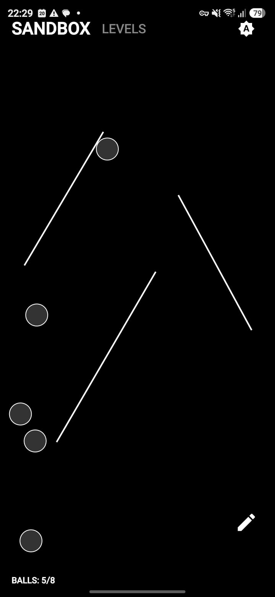

# HapticBall

An Android physics sandbox built with Jetpack Compose, with haptic feedback that changes depending on what the ball hits and how hard.



## Features

- **Physics**: Verlet integration, collision detection that avoids tunneling, and a normalized 1000x1000 world so it behaves the same on any screen.
- **Haptics**: Different vibrations for walls, balls and obstacles. Intensity scales with impact speed, and impacts lower on the screen feel deeper. Uses the Android 11+ haptic composition API with fallbacks for older devices.
- **Sandbox**: Spawn balls, draw obstacles and tweak gravity and viscosity.
- **Levels**: 10 puzzle levels with lethal red obstacles. Progress is saved.

## Installation

1. Clone the repository:
   ```bash
   git clone https://github.com/RoshTzsche/zen_haptics.git
   ```
2. Open it in Android Studio (Ladybug or newer).
3. Run it on a physical device. Emulators don't support the haptics.

## How to play

- **Long press** the background to open physics settings or the level selector.
- **Sandbox**: use the floating button to switch between GRAB (move balls) and DRAW (create obstacles).
- **Levels**: get the ball to the goal without touching red lines. Use the refresh button to restart.

## License

MIT. See [LICENSE](LICENSE).
